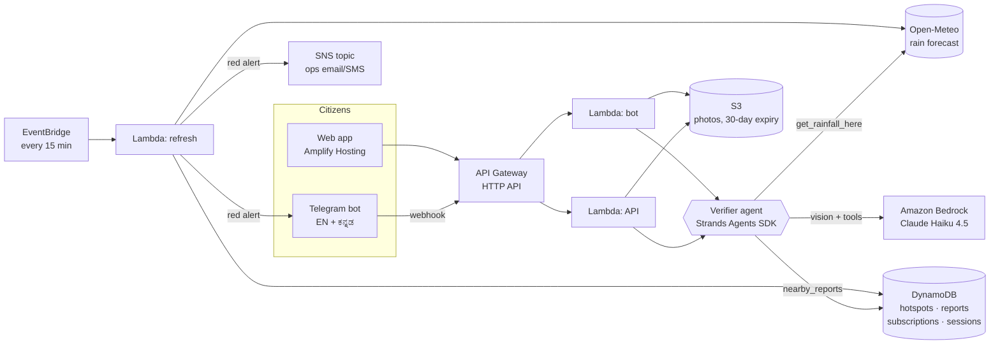

# ನೀರು Neeru — know before you ride into it

**Flood alerts for Bengaluru's underpasses and junctions, verified by citizen photos.**
Built for Environmental Hacks 2026 (Bharat Builds Tour · AWS Builder Center × WeMakeDevs), **Heat and Water track**.

Every monsoon, the same underpasses fill up, and the people who pay for it are the ones on two
wheelers: delivery partners, commuters, students. They find out a road is flooded when they are
already in the water. Neeru answers one question for them: **"Will the road on my way flood in the
next 3 hours?"** It also tells ward engineers **where to send pumps first**.

## What it does

| For | How |
|---|---|
| **Riders** | Telegram bot in **English and ಕನ್ನಡ** (no app to install) and a mobile web map. Share your location: see the risk at the spots near you for the next 3 hours. Tap **Alert me** and get a message *before* a spot turns red. |
| **Citizens** | Send a photo of a waterlogged road. An **AI agent** checks it: is it a real street photo, how deep is the water (ankle / tyre-hub / knee), does live rainfall back it up, do other reports agree? Confirmed reports go on the map within seconds, and a report far from known spots **adds a new spot to the map**. |
| **Ward engineers / traffic police** | **Dispatch priority** list: risk × road importance × verified citizen reports. Red alerts also go out on an SNS topic (email/SMS). |

### The risk model is simple, explainable, and learns
Each spot has a **flood threshold** (mm of rain load) and a **drain half-life**.
`rain load = rain from the last 3 h, decayed by how fast this spot drains + rain forecast for the next 3 h`.
`score = max(rain load / threshold, floor set by fresh verified photos)` → green < 0.5 ≤ amber < 1 ≤ red.

When citizens photograph a flood the model did not expect, that spot's threshold drops; when they
show a dry road in heavy rain, it rises. **Every verified photo makes the map more accurate.**
All of this is in [`src/neeru/risk.py`](src/neeru/risk.py), with a worked example in the docstrings.

## Architecture



**AWS used:** Strands Agents SDK (AWS open source), Amazon Bedrock, Lambda, API Gateway (HTTP API),
DynamoDB, S3, EventBridge, SNS, Amplify Hosting, CloudWatch Logs, deployed with **AWS SAM**.

## The verifier agent
[`src/neeru/verifier.py`](src/neeru/verifier.py) — a Strands agent with a step-by-step procedure in its
system prompt and three tools:

1. `get_rainfall_here()` — real rain at the photo's location (past 3 h, next 3 h)
2. `nearby_reports()` — what other citizens reported at the nearest hotspot recently
3. `submit_verdict(...)` — the structured answer: valid photo? depth? confidence? reason? advice in the reporter's language

Only **valid, confident (≥ 0.6)** verdicts can move the map. If Bedrock is down, the report is kept as
unverified and nothing breaks. Text inside photos is treated as data, never as instructions.

## Run it

### 0. Prerequisites
Python 3.12, [AWS CLI](https://docs.aws.amazon.com/cli/latest/userguide/getting-started-install.html), [SAM CLI](https://docs.aws.amazon.com/serverless-application-model/latest/developerguide/install-sam-cli.html), an AWS account in **ap-south-1 (Mumbai)**, a Telegram bot token from **@BotFather**.
In the Bedrock console (Mumbai), open the playground once with **Claude Haiku 4.5** so the model is enabled for your account, and copy its **inference profile ID** from *Inference profiles* (the default in `template.yaml` is `global.anthropic.claude-haiku-4-5-20251001-v1:0`).

### 1. Try it locally (no AWS needed)
```bash
pip install -r requirements-dev.txt
python -m pytest            # 49 tests
python scripts/local_demo.py   # http://localhost:8000 — fake AWS, storm replay, stand-in verifier
```

### 2. Deploy
```bash
sam build                      # needs Python 3.12 on PATH; otherwise: sam build --use-container
sam deploy --guided --stack-name neeru --region ap-south-1 --capabilities CAPABILITY_IAM
#   TelegramBotToken = token from BotFather
#   TelegramSecret   = any 20+ chars of letters/digits/_/-   (e.g. python -c "import secrets;print(secrets.token_urlsafe(24))")
#   AdminToken       = another random string
#   ModelId          = your inference profile ID (or keep the default)
#   AlertEmail       = optional, confirm the SNS email you receive

pip install boto3
python scripts/seed_hotspots.py
TELEGRAM_BOT_TOKEN=... TELEGRAM_SECRET=... python scripts/set_webhook.py
curl -X POST "$API_URL/admin/refresh" -H "x-admin-token: $ADMIN_TOKEN"
TELEGRAM_BOT_USERNAME=your_bot python scripts/build_web.py   # -> dist/neeru-web.zip
```
Amplify console → **Create new app → Deploy without Git** → upload `dist/neeru-web.zip`.

### 3. Storm replay (for demos when it isn't raining)
```bash
curl -X POST "$API_URL/admin/replay" -H "x-admin-token: $ADMIN_TOKEN" \
  -H "content-type: application/json" \
  -d '{"action":"start","lat":12.926,"lon":77.681,"peak_mm_hr":35,"radius_km":6,"minutes":30}'
# stop: -d '{"action":"stop"}'
```
Replayed rain is **labelled everywhere it appears** (banner on the map, note on every bot message,
`[STORM REPLAY DEMO]` on SNS alerts). It never mixes silently with real data.

## API
| Route | |
|---|---|
| `GET /hotspots` | all spots with current risk |
| `GET /hotspots/{id}` | one spot + citizen photos from the last 6 h (presigned links) |
| `GET /priority` | red/amber spots in dispatch order |
| `POST /reports` | `{lat, lon, image_base64, lang}` → agent verdict |
| `POST /telegram` | bot webhook (secret-token protected, de-duplicated) |
| `POST /admin/replay`, `POST /admin/refresh` | `x-admin-token` header |

## Cost
Pay-per-request everything. A weekend of demo traffic stays inside the AWS Free Tier credits; the
main variable cost is Bedrock at a fraction of a rupee per verified photo with Haiku.

## Honest limitations
- The 16 seed hotspots and their thresholds are a starting point from public reporting, not official
  data. Coordinates are approximate. The thresholds are designed to be corrected by citizen reports.
- Open-Meteo is a global model; it misses very local cloudbursts. That gap is exactly why citizen
  photos can override it.
- Depth from a photo is an estimate. The agent is told to pick the shallower option when unsure.

## Built with
AWS SAM, Strands Agents SDK, Amazon Bedrock, Open-Meteo, Leaflet, OpenStreetMap / CARTO tiles.
AI coding assistant used: **Claude (Anthropic)** for scaffolding and review.

Team **QuantumEffect** — Pratham Patil, Rishikesh Bulagouda.
